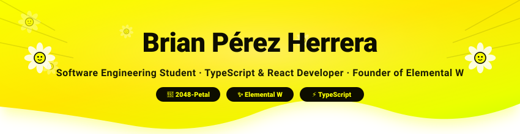
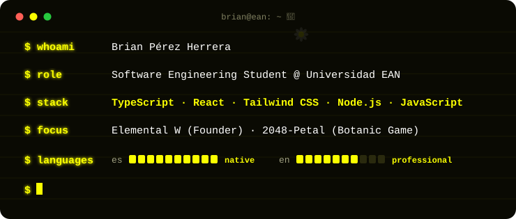

 

 

 

  🌼 ────────── 🌼 ────────── 🌼

 

  

 

  🌼 ────────── 🌼 ────────── 🌼

---

###  Sobre mí / About Me 

<table>
<tr>
<td align="center" width="100%" style="padding: 24px; line-height: 1.8;">

 **Estudiante de Ingeniería de Software** @ Universidad EAN  
 
 **Desarrollador Web & Frontend:** Especializado en TypeScript, React, Tailwind CSS y Node.js  
 
 **Fundador de [Elemental W](https://brianperez22.github.io/ElementalW-Proyect/):** Ecosistema interactivo y gamificado de ciencias básicas con Chispa  
 
 **Creador de [2048-Petal](https://github.com/BrianPerez22/2048-Petal):** Videojuego botánico interactivo en la web inspirado en margaritas  
 
 **Linux & Cybersecurity:** Apasionado por sistemas, arquitectura y entornos UNIX  
 
 **Diseño Gráfico & UI/UX:** Creación de componentes estéticos, identidades visuales y animaciones SVG  

 

🌼 <i>"Uniendo curiosidad científica, diseño floral y código limpio en cada proyecto."</i> 🌼

</td>
</tr>
</table>

---

###  Stack Principal / Core Tech Stack

Tecnologías que utilizo para construir aplicaciones interactivas, interfaces reactivas y simuladores:

<table>
  <tr>
    <td align="center" width="130">
       
      <b>TypeScript</b> 
      
    </td>
    <td align="center" width="130">
       
      <b>React</b> 
      
    </td>
    <td align="center" width="130">
       
      <b>Tailwind CSS</b> 
      
    </td>
    <td align="center" width="130">
       
      <b>Node.js</b> 
      
    </td>
    <td align="center" width="130">
       
      <b>JavaScript</b> 
      
    </td>
  </tr>
</table>

 

---

###  Proyectos Destacados / Featured Projects

<table>
<tr>
<td width="50%" valign="top">

####  [Elemental W](https://brianperez22.github.io/ElementalW-Proyect/)
**Plataforma Interactiva de Ciencias Básicas**

Ecosistema educativo interactivo y gamificado diseñado para el aprendizaje profundo de **Química, Física y Cálculo**. Incorpora laboratorios virtuales, simuladores científicos interactivos, retos evaluativos guiados y la compañía del mentor inteligente **Chispa** ✨.

- 🌐 **Sitio Web:** [brianperez22.github.io/ElementalW-Proyect](https://brianperez22.github.io/ElementalW-Proyect/)
- 💻 **Repositorio:** [BrianPerez22/ElementalW-Proyect](https://github.com/BrianPerez22/ElementalW-Proyect)
- ✨ **Mascota & Guía:** Chispa
- 🛠️ `React` · `TypeScript` · `JavaScript` · `Tailwind CSS`

</td>
<td width="50%" valign="top">

####  [2048-Petal](https://github.com/BrianPerez22/2048-Petal)
**Juego Botánico de Margaritas & Pétalos**

Reinterpretación botánica del legendario 2048 donde los números se convierten en pétalos florales que germinan y se fusionan estratégicamente hasta hacer florecer la margarita dorada de 2048.

- 🌼 **Repositorio:** [BrianPerez22/2048-Petal](https://github.com/BrianPerez22/2048-Petal)
- 🌿 **Estética:** Pétalos, margaritas y luz amarillo neón
- 🛠️ `TypeScript` · `React (TSX)` · `HTML5` · `CSS3`

</td>
</tr>
</table>

---

  

---

  🌼 🌼 🌼 Construido con margaritas, la chispa de la curiosidad ✨ y tecnología en amarillo neón 🌼 🌼 🌼

